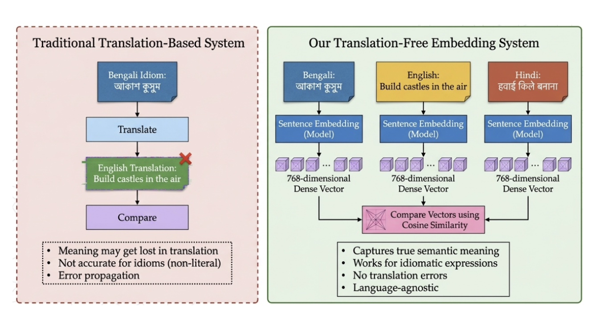

# Cross-Lingual Bengali Idiom Matching Using Multilingual Sentence Embeddings Without Translation

[](https://www.python.org/downloads/release/python-3100/)
[](https://github.com/huggingface/transformers)
[](https://www.sbert.net/)
[](LICENSE)

---

## 📖 Overview

Idiomatic expressions are among the most challenging phenomena in natural language processing (NLP) because their meaning is **non-compositional**—it cannot be inferred from the literal interpretation of their constituent words. For example, the Bengali idiom **"আকাশ কুসুম"** (literally "sky flower") conveys the notion of an **impossible dream**, a concept echoed in English by *"build castles in the air"* and in Hindi by *"हवाई किले बनाना"*.

This project investigates whether **state-of-the-art multilingual sentence embedding models** can identify semantically equivalent idioms across **Bengali, English, and Hindi** without relying on any translation mechanism.

The study systematically compares **four pretrained models** representing distinct training paradigms:

- **mSBERT** (Multilingual Sentence-BERT) — a paraphrase-distilled multilingual sentence embedder
- **LaBSE** (Language-Agnostic BERT Sentence Embedding) — a dual-encoder model trained on massive translation pairs
- **BanglaBERT** — a monolingual BERT model pre-trained exclusively on Bengali text
- **XLM-RoBERTa-base** — a general-purpose multilingual encoder trained on 100 languages

<p align="center">
  
</p>

<p align="center"><em>Figure: Traditional translation-based matching (left) vs. our translation-free approach (right), where Bengali, English and Hindi idioms are embedded directly into a shared 768-dimensional space and compared via cosine similarity.</em></p>

---

## 🎯 Research Objectives

### Primary Objective
**Compare the performance** of mSBERT, LaBSE, BanglaBERT, and XLM-RoBERTa-base on cross-lingual Bengali idiom matching with English and Hindi equivalents, **without using any translation system**.

### Specific Tasks
1. **Semantic Similarity Scoring** — Quantify the cosine similarity that each model assigns to known Bengali-English and Bengali-Hindi idiom pairs that share the same figurative meaning.

2. **Cross-Lingual Retrieval** — Measure how often the correct target-language idiom appears at the top of a ranked list when a Bengali query is issued.

3. **Semantic Clustering** — Analyse the structure of the combined embedding space through K-Means clustering, assessing cluster purity, silhouette score, and triplet cohesion (fraction of triplets where all three languages co-cluster).

### Tertiary Objectives
- Build a curated cross-lingual idiom triplet dataset for Bengali, English, and Hindi
- Determine which model better captures figurative language across language boundaries
- Examine the effect of linguistic proximity (Indo-Aryan family) on model performance
- Identify the role of monolingual pre-training depth versus cross-lingual alignment
- Identify limitations of current off-the-shelf models and propose directions for future work

---

## 💾 Dataset Construction

### Data Sources

| Dataset | Language | Size | Format | Key Field |
|---------|----------|------|--------|-----------|
| **Bagdhara** | Bengali | ~8,800 idioms | One JSON file per idiom | `similar_in_english` (list of English equivalents) |
| **Bengali-Bangla JSON** | Bengali | ~6 idioms | Array JSON | `figurative_meaning` (English text) |
| **English JSON (MAGPIE)** | English | ~14,200+ idioms | Array JSON | `figurative_meaning` (English text) |
| **Hindi JSON** | Hindi | ~450+ idioms | Array JSON | `figurative_meaning` (English text — required) |

### Alignment Strategies

**Strategy A (High Confidence):** For each Bengali idiom in the Bagdhara dataset, the `similar_in_english` field directly supplies the English equivalent(s). The Hindi equivalent is found using a keyword-overlap bridge on the English figurative meaning descriptions.

**Strategy B (Medium Confidence):** For Bengali idioms not in Bagdhara, both English and Hindi equivalents are found by keyword overlap on the `figurative_meaning_en` field.

### Dataset Statistics

| Pair Type | Number of Pairs | Used In |
|-----------|----------------|---------|
| Bengali-English (bn-en) | 9,061 pairs | Similarity, Retrieval, Clustering |
| Bengali-Hindi (bn-hi) | 4,096 pairs | Similarity, Retrieval, Clustering |
| **Total idioms embedded** | **23,544** (bn+hi+en) | Clustering |

---

## 🧠 Models Compared

### 1. mSBERT (Multilingual Sentence-BERT)
- **Developer:** UKPLab (Reimers & Gurevych, 2020)
- **HuggingFace ID:** `paraphrase-multilingual-mpnet-base-v2`
- **Languages Supported:** 50+ languages
- **Training Objective:** Paraphrase similarity across languages (knowledge distillation)
- **Best Suited For:** Semantic equivalence & paraphrase detection
- **Output:** 768-dimensional L2-normalised vectors

### 2. LaBSE (Language-Agnostic BERT Sentence Embedding)
- **Developer:** Google Research (Feng et al., 2022)
- **HuggingFace ID:** `sentence-transformers/LaBSE`
- **Languages Supported:** 109 languages
- **Training Objective:** Translation pair alignment (dual-encoder with additive margin softmax)
- **Best Suited For:** Cross-lingual sentence alignment
- **Output:** 768-dimensional L2-normalised vectors

### 3. BanglaBERT
- **Developer:** BUET, CSE (Bhattacharjee et al., 2022)
- **HuggingFace ID:** `csebuetnlp/banglabert`
- **Languages Supported:** Primarily Bengali (Bangla)
- **Training Objective:** Masked Language Modeling (MLM)
- **Training Data:** ~18.6GB to 27.5GB of crawled Bangla web data
- **Best Suited For:** Bangla NLU tasks (classification, NER, etc.)
- **Output:** 768-dimensional token-level representations (mean pooled for sentence embeddings)

### 4. XLM-RoBERTa-base
- **Developer:** Meta AI (Conneau et al., 2020)
- **HuggingFace ID:** `FacebookAI/xlm-roberta-base`
- **Languages Supported:** 100 languages
- **Training Objective:** Masked Language Modeling (MLM)
- **Training Data:** 2.5TB of filtered CommonCrawl data
- **Best Suited For:** Cross-lingual understanding, transfer learning
- **Output:** 768-dimensional token-level representations (mean pooled for sentence embeddings)

---

## 🔬 Evaluation Methodology

### Task 1: Semantic Similarity Scoring
**Objective:** How closely does the model place equivalent cross-lingual idioms together in vector space?

**Metric:** Cosine Similarity [-1 to 1]

**Process:** For every ground-truth pair (Bengali-English and Bengali-Hindi), we compute the dot product of their L2-normalised embeddings.

**Formula:**
$$\text{sim}(a,b) = \mathbf{a} \cdot \mathbf{b} = \sum_{i=1}^{d} a_i b_i$$

A higher mean cosine similarity indicates a tighter cross-lingual semantic alignment.

---

### Task 2: Cross-Lingual Retrieval
**Objective:** Given a Bengali idiom query, can the model successfully retrieve the exact English or Hindi equivalent from a massive candidate pool?

**Metrics:**

| Metric | Definition | Perfect Score | Interpretation |
|--------|------------|---------------|----------------|
| **MRR** (Mean Reciprocal Rank) | Average of 1/rank of correct answer | 1.0 | If correct answer always ranked 1st |
| **P@1** (Precision at 1) | Fraction of queries where rank 1 = correct | 1.0 | Strictest metric — top result must be correct |
| **P@5** (Precision at 5) | Fraction of queries where correct is in top 5 | 1.0 | More lenient — correct answer anywhere in top 5 |
| **Hit@10** | Fraction of queries where correct is in top 10 | 1.0 | Most lenient — correct answer anywhere in top 10 |

---

### Task 3: Cross-Lingual Clustering
**Objective:** Do semantically equivalent idioms naturally form distinct, isolated clusters in the continuous embedding space, regardless of their language?

**Metrics:**

| Metric | Definition | Ideal Score | What It Tells You |
|--------|------------|-------------|-------------------|
| **Silhouette Score** | How well-separated clusters are from each other | +1.0 | Negative = clusters overlap; +1 = perfectly separated |
| **Cluster Purity** | Fraction of each cluster dominated by one language | 1.0 | High purity = each cluster is mostly one language (less cross-lingual mixing) |
| **Triplet Cohesion** | Fraction of triplets where all 3 languages land in same cluster | 1.0 | Best measure of genuine cross-lingual understanding |

**Implementation:** All 23,544 idiom embeddings are clustered using K-Means with `k = 50`.

---

### Task 4: Monolingual Bengali Evaluation
**Objective:** Evaluate the quality of the monolingual Bengali embedding space, particularly for BanglaBERT.

**Process:** Bengali embeddings from each model are clustered using K-Means with `k = 887` (approximately the number of distinct Bengali idioms divided by 10). Only the Silhouette Score is computed.

---

## 📊 Results

### 1. Semantic Similarity Scoring

| Model | Lang Pair | N Pairs | Mean Cosine | Std Dev | Median |
|-------|-----------|---------|-------------|---------|--------|
| **mSBERT** | bn-en | 9,061 | 0.4376 | 0.1422 | 0.4317 |
| **LaBSE** | bn-en | 9,061 | 0.3878 | 0.2028 | 0.3607 |
| **XLM-R** | bn-en | 9,061 | **0.9932** | 0.0029 | 0.994 |
| **mSBERT** | bn-hi | 4,096 | **0.5629** | 0.1392 | 0.5637 |
| **LaBSE** | bn-hi | 4,096 | 0.2879 | 0.1331 | 0.2752 |
| **XLM-R** | bn-hi | 4,096 | **0.9934** | 0.0031 | 0.9943 |

**Key Insights:**
- **XLM-R** produces near-perfect mean similarity (≈0.993) for both pairs, but this is a symptom of **catastrophic embedding collapse** — all vectors are nearly identical (σ ≈ 0.003), making the scores meaningless.
- **mSBERT** scores Bengali-Hindi pairs (0.563) significantly higher than Bengali-English pairs (0.438), reflecting the **Indo-Aryan linguistic proximity** between Bengali and Hindi.
- **LaBSE** shows the opposite pattern, scoring bn-hi (0.288) lower than bn-en (0.388), suggesting bias toward English-centric training data.

**Statistical Significance:**
- bn-en: mean difference = 0.0498, t = 7.91, p < 0.001
- bn-hi: mean difference = 0.2750, t = 103.46, p < 0.001

---

### 2. Cross-Lingual Retrieval Metrics

| Model | Lang Pair | N Queries | MRR | P@1 | P@5 | Hit@10 |
|-------|-----------|-----------|-----|-----|-----|--------|
| **mSBERT** | bn-en | 9,061 | 0.0011 | 0.0004 | 0.0019 | 0.0028 |
| **mSBERT** | bn-hi | 4,096 | 0.0073 | 0.0029 | 0.0114 | 0.0232 |
| **LaBSE** | bn-en | 9,061 | **0.0084** | **0.0055** | **0.0119** | **0.0148** |
| **LaBSE** | bn-hi | 4,096 | **0.0145** | **0.0075** | **0.0241** | **0.0350** |
| **XLM-R** | bn-en | 9,061 | 0.0001 | 0.0000 | 0.0003 | 0.0004 |
| **XLM-R** | bn-hi | 4,096 | 0.0068 | 0.0019 | 0.0115 | 0.0245 |

**Key Insights:**
- **LaBSE consistently outperforms** both mSBERT and XLM-R across every retrieval metric and both language pairs.
- For bn-en, LaBSE's MRR (0.0084) is over **seven times higher** than mSBERT's (0.0011).
- All models exceed the random baseline (≈0.002 for bn-en, ≈0.005 for bn-hi), confirming rankings are not random.
- Retrieval performance is **significantly better for bn-hi than bn-en** for all models, reinforcing the role of linguistic proximity.

---

### 3. Cross-Lingual Clustering Metrics

| Model | Silhouette | Purity | Triplet Cohesion |
|-------|------------|--------|------------------|
| **mSBERT** | -0.0180 | 0.9020 | 0.0106 (1.1%) |
| **LaBSE** | **0.0408** | **0.7453** | **0.0176 (1.8%)** |
| **XLM-R** | **0.0419** | **0.9853** | **0.0000 (0%)** |

**Key Insights:**
- **LaBSE** achieves the most language-agnostic space — lowest purity (0.745) and highest triplet cohesion (1.8%).
- **mSBERT** shows negative silhouette (-0.018) and high purity (0.902), indicating language-segregated, overlapping clusters.
- **XLM-R** has positive silhouette (0.042) and extremely high purity (0.985) but **zero triplet cohesion** — it completely separates languages.
- The positive silhouette for XLM-R is an **artifact of collapse** — since all vectors are nearly identical, K-Means assigns them arbitrarily, creating artificially separated clusters.

---

### 4. Monolingual Bengali Evaluation

| Model | Self-Similarity (Mean Cosine) | Silhouette Score (K=887) |
|-------|-------------------------------|---------------------------|
| **mSBERT** | 0.6814 | -0.0200 |
| **LaBSE** | 0.3307 | **+0.0338** |
| **XLM-R** | **0.9942** | -0.0509 |
| **BanglaBERT** | 0.8306 | -0.0350 |

**Key Insights:**
- **XLM-R** produces near-perfect mean cosine (0.994) but negative silhouette (-0.051) — confirmed embedding collapse.
- **LaBSE** gives the lowest mean similarity (0.331) and the **only positive silhouette** (0.034) — well-spread, discriminative space.
- **BanglaBERT** (0.831 mean, -0.035 silhouette) and **mSBERT** (0.681 mean, -0.020 silhouette) occupy an intermediate range.

---

## 🏆 Final Verdict

### Cross-Lingual Tasks Score Tally

| Evaluation Aspect | Winner |
|-------------------|--------|
| Semantic Similarity (bn-en) | XLM-R (invalid due to collapse) |
| Semantic Similarity (bn-hi) | XLM-R (invalid due to collapse) |
| Cross-Lingual Retrieval (MRR) | LaBSE |
| Cross-Lingual Retrieval (P@1) | LaBSE |
| Cross-Lingual Retrieval (P@5) | LaBSE |
| Cross-Lingual Retrieval (Hit@10) | LaBSE |
| Cross-Lingual Clustering (Silhouette) | XLM-R (artifact of collapse) |
| Cross-Lingual Clustering (Purity) | XLM-R (artifact of collapse) |
| Cross-Lingual Clustering (Triplet Cohesion) | LaBSE |
| Monolingual Bengali (Self-Similarity) | XLM-R (invalid due to collapse) |
| Monolingual Bengali (Silhouette) | LaBSE |

### Final Tally (Legitimate Wins)

| Model | Legitimate Wins |
|-------|-----------------|
| **LaBSE** | **6** |
| **XLM-R** | 0 (invalid) |
| **mSBERT** | 0 |
| **BanglaBERT** | 0 |

---

### 👑 Overall Winner: LaBSE (Language-Agnostic BERT Sentence Embedding)

LaBSE emerges as the most **balanced** and **reliable** model for cross-lingual idiom matching, excelling in:

1. **Retrieval** — superior discriminative ranking ability
2. **Triplet Cohesion** — best at grouping the same figurative concept across all three languages
3. **Monolingual Bengali Silhouette** — best fine-grained discrimination
4. **Language Agnosticism** — lowest purity (most cross-lingual mixing)

---

### Model-Specific Recommendations

| Use Case | Recommended Model |
|----------|-------------------|
| **Search-oriented applications** (cross-lingual idiom search, translation assistance) | **LaBSE** |
| **Semantic similarity confidence** / linguistic proximity detection | **mSBERT** |
| **Monolingual Bengali tasks** (classification, NER, etc.) | **BanglaBERT** |
| **Any cross-lingual idiom task** | **Avoid XLM-R** (embedding collapse) |

---

## 📁 Repository Structure

```
Cross-Lingual-Bengali-Idiom-Matching-Using-Multilingual-Sentence-Embeddings-Without-Translation/
│
├── README.md                           # Main documentation (this file)
│
├── code/                               # Complete implementation
│   ├── README.md                       # Detailed code documentation
│   ├── requirements.txt                # Python dependencies
│   │
│   ├── data/
│   │   ├── raw/                        # Source datasets
│   │   │   ├── bagdhara/               # ~8,800 Bengali idioms (JSON)
│   │   │   ├── english.json            # ~14,200+ English idioms
│   │   │   └── hindi.json              # ~450+ Hindi idioms
│   │   │
│   │   └── processed/                  # Preprocessed outputs
│   │       ├── clean_bengali.csv
│   │       ├── clean_english.csv
│   │       ├── clean_hindi.csv
│   │       ├── pairs_bn_en.csv
│   │       ├── pairs_bn_hi.csv
│   │       └── triplets.csv
│   │
│   ├── src/                            # Source code (pipeline scripts)
│   │   ├── data_loader.py              # Load and parse raw datasets
│   │   ├── data_preprocessor.py        # Clean and preprocess data
│   │   ├── 03_embedder.py              # Generate embeddings for all models
│   │   ├── 04_similarity.py            # Compute semantic similarity
│   │   ├── 05_retrieval.py             # Perform cross-lingual retrieval
│   │   ├── 06_clustering.py            # Perform K-Means clustering
│   │   ├── 07_evaluate.py              # Aggregate all metrics
│   │   ├── 08_compare_models.py        # Statistical tests and final verdict
│   │   ├── run_all.py                  # Master orchestrator script
│   │   └── tojson.py                   # Utility for JSON conversion
│   │
│   └── results/                        # Auto-generated outputs
│       ├── embeddings/                 # .npy vector arrays per model
│       │   ├── BanglaBERT/
│       │   ├── LaBSE/
│       │   ├── mSBERT/
│       │   └── XLM-R/
│       │
│       ├── plots/                      # Visualizations
│       │   ├── clustering_LaBSE.png
│       │   ├── clustering_mSBERT.png
│       │   ├── clustering_XLM-R.png
│       │   ├── evaluation_radar.png
│       │   ├── final_comparison_crosslingual.png
│       │   ├── final_comparison_monolingual.png
│       │   ├── monolingual_radar.png
│       │   └── score_distributions.png
│       │
│       ├── full_evaluation_report.csv
│       ├── model_comparison_summary.txt
│       ├── similarity_scores.csv
│       ├── retrieval_metrics.csv
│       └── clustering_metrics.csv
│
├── papers_read/                        # Reference literature
│   ├── Alankaar: A Dataset for Figurativeness Understanding in Bangla.pdf
│   ├── Attention is All You Need.pdf
│   ├── BanglaBERT.pdf
│   ├── BERT.pdf
│   ├── Language-agnostic BERT Sentence Embedding.pdf
│   ├── Sentence-BERT.pdf
│   ├── Unsupervised Cross-lingual Representation Learning at Scale.pdf
│   └── When Words Don't Mean What They Say.pdf
│
└── thesis/                             # Final deliverables
    ├── presentation/                   # Presentation slides
    │   ├── Ankana Saha.pdf
    │   ├── Avrodeep Pal.pdf
    │   └── Shahmeer Mondal.pdf
    │
    └── reports/                        # Full project reports
        ├── Ankana Saha.pdf
        ├── Avrodeep Pal.pdf
        └── Shahmeer Mondal.pdf
```

---

## 🚀 Getting Started

### Prerequisites

- **Python 3.10+**
- **CUDA-compatible GPU** (recommended for embedding generation)
- **Minimum 32GB RAM**

### Installation

1. **Clone the repository:**

```bash
git clone https://github.com/your-username/Cross-Lingual-Bengali-Idiom-Matching.git
cd Cross-Lingual-Bengali-Idiom-Matching/code
```

2. **Install dependencies:**

```bash
pip install -r requirements.txt
```

**Requirements:**
```
torch>=2.0.0
transformers>=4.36.0
sentence-transformers>=2.2.2
numpy>=1.24.0
pandas>=2.0.0
scikit-learn>=1.3.0
matplotlib>=3.7.0
umap-learn>=0.5.0
scipy>=1.10.0
```

3. **Download datasets:**

Place the following files in `data/raw/`:
- `bagdhara/` folder with ~8,800 Bengali idiom JSON files
- `english.json` (~14,200+ English idioms)
- `hindi.json` (~450+ Hindi idioms)

### Running the Pipeline

**Run the complete end-to-end pipeline:**

```bash
python src/run_all.py
```

**Resume from a specific step:**

```bash
python src/run_all.py --from 5   # Skip embedding, start at Retrieval
```

**Pipeline Steps:**
1. `01_data_loader.py` — Compile raw datasets
2. `02_data_preprocessor.py` — Normalize text and build triplets
3. `03_embedder.py` — Generate embeddings (.npy arrays)
4. `04_similarity.py` — Calculate cross-lingual and monolingual cosine similarity
5. `05_retrieval.py` — Execute nearest neighbor search for MRR
6. `06_clustering.py` — Run K-Means clustering
7. `07_evaluate.py` — Aggregate metrics into `full_evaluation_report.csv`
8. `08_compare_models.py` — Run statistical tests and print final verdict

---

## 📈 Output Artifacts

| File | Description |
|------|-------------|
| `results/embeddings/*.npy` | Dense vector representations for each model and language |
| `results/similarity_scores.csv` | Cosine similarity for all ground-truth pairs |
| `results/retrieval_metrics.csv` | MRR, P@1, P@5, Hit@10 for all models |
| `results/clustering_metrics.csv` | Silhouette, Purity, Triplet Cohesion |
| `results/full_evaluation_report.csv` | All metrics combined |
| `results/model_comparison_summary.txt` | Final verdict and score tally |
| `results/plots/*.png` | Visualization charts and radar plots |

---

## 🔬 Research Contributions

1. **A new cross-lingual idiom dataset** aligned across Bengali, English, and Hindi — filling a resource gap for low-resource figurative language evaluation.

2. **The first systematic multi-task comparison** of four models (mSBERT, LaBSE, XLM-R, BanglaBERT) on non-compositional, figurative semantics.

3. **Empirical evidence of embedding collapse** in general-purpose multilingual encoders (XLM-R) when applied to fine-grained tasks with low-resource languages.

4. **Demonstration of linguistic proximity effects** within the Indo-Aryan family: mSBERT's higher performance on Bengali-Hindi vs. Bengali-English confirms that multilingual models can leverage shared etymological and cultural features.

5. **A rigorous, reproducible evaluation framework** combining similarity scores, retrieval metrics, clustering analysis (including triplet cohesion), and monolingual diagnostics.

---

## 📚 References

### Key Papers

1. **Devlin, J., et al. (2019).** BERT: Pre-training of Deep Bidirectional Transformers for Language Understanding. *NAACL 2019*.

2. **Reimers, N., & Gurevych, I. (2019).** Sentence-BERT: Sentence Embeddings using Siamese BERT-Networks. *EMNLP-IJCNLP 2019*.

3. **Feng, F., et al. (2022).** Language-agnostic BERT Sentence Embedding. *ACL 2022*.

4. **Conneau, A., et al. (2020).** Unsupervised Cross-lingual Representation Learning at Scale. *ACL 2020*.

5. **Bhattacharjee, A., et al. (2022).** BanglaBERT: Language Model Pretraining and Benchmarks for Low-Resource Language Understanding Evaluation in Bangla. *NAACL 2022 Findings*.

6. **Sakhawat, A., et al. (2026).** When Words Don't Mean What They Say: Figurative Understanding in Bengali Idioms. *arXiv:2602.12921*.

7. **Rakshit, G., & Flanigan, J. (2025).** Alankaar: A Dataset for Figurativeness Understanding in Bangla. *RANLP 2025*.

### Datasets

- **Bagdhara Dataset:** [https://doi.org/10.34740/kaggle/dsv/13468825](https://doi.org/10.34740/kaggle/dsv/13468825)
- **Multilingual Idioms - Indian:** [https://www.kaggle.com/datasets/aryanrahultandon/multilingual-idioms-indian/data](https://www.kaggle.com/datasets/aryanrahultandon/multilingual-idioms-indian/data)

---

## 👨‍🔬 Authors

| Name | Exam Roll | Class Roll | Registration |
|------|-----------|------------|--------------|
| **Ankana Saha** | MCA00264009 | 002410503037 | 1665840 of 2024-25 |
| **Avrodeep Pal** | MCA00264031 | 002410503011 | 1665814 of 2024-25 |
| **Shahmeer Mondal** | MCA00264038 | 002410503039 | 1665842 of 2024-25 |

**Supervisor:** Prof. Diganta Saha

**Department of Computer Science and Engineering**  
**Jadavpur University, Kolkata - 700032, India**

---

## 📄 License

This project is licensed under the MIT License - see the LICENSE file for details.

---

## 🙏 Acknowledgements

We would like to thank:

- **Prof. Diganta Saha** for his invaluable guidance and support throughout this project.
- **All professors** of the Department of Computer Science and Engineering, Jadavpur University.
- **Jadavpur University** for providing the academic resources and infrastructure.
- **Our fellow classmates and families** for their constant support and understanding.

---

## 📧 Contact

For any queries regarding this project, please contact:

- **Ankana Saha:** ankanasaha1922@gmail.com
- **Avrodeep Pal:** avrodeep.pal17@gmail.com
- **Shahmeer Mondal:** shahmeermondal1576@gmail.com

---

**"The figurative heart of language - its idioms - is not entirely opaque to multilingual neural models."**

*~ From the final remarks of the thesis*